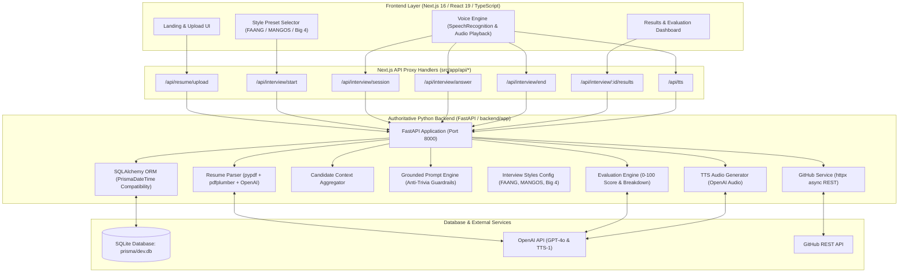

# IntervAI — Resume-Grounded AI Technical Interviewer

> **"Upload your resume. IntervAI understands your projects and conducts a real-time technical voice interview about your own experience."**

[](https://nextjs.org/)
[](https://fastapi.tiangolo.com/)
[](https://www.python.org/)
[](https://www.typescriptlang.org/)
[](https://platform.openai.com/)
[](https://www.sqlalchemy.org/)
[](https://www.sqlite.org/)

---

## 🌟 Executive Overview

**IntervAI** is a hybrid full-stack, voice-first AI technical interviewer designed to eliminate generic textbook mock interview questions. Instead of selecting broad topics like DSA, DBMS, or NLP, IntervAI inspects the candidate's actual PDF resume and publicly linked GitHub repositories (extracting `README.md` documentation and codebase file structure) to build a normalized **Candidate Context Dossier**.

The interviewer conducts a live voice conversation—speaking every question aloud and using automatic Voice Activity Detection (VAD) to listen to candidate answers through the microphone—probing system architecture, design trade-offs, edge cases, and scalability.

---

## 🏗️ Architecture: Next.js Frontend + FastAPI Python Backend

IntervAI operates as a high-performance **hybrid architecture**:

- **Frontend & Browser Layer (Next.js 16 + React 19 + TypeScript):** Handles cinematic motion UI, resume upload dropzones, company style selection cards, live audio playback, Web Speech API speech-to-text, and microphone turn detection (VAD).
- **Backend Business Logic Layer (Python 3.11+ + FastAPI + SQLAlchemy):** Authoritative server-side intelligence handling multi-strategy PDF parsing (`pypdf` + `pdfplumber`), GitHub repository inspection (`httpx`), grounded system prompt generation, company style directives, OpenAI SDK structured parsing and evaluations, TTS audio synthesis, and database operations.
- **Transparent API Proxying:** The existing Next.js API routes under `src/app/api/` act as lightweight TypeScript proxy handlers forwarding client requests to the FastAPI backend (`http://127.0.0.1:8000`), preserving all existing frontend API contracts, status codes, multipart file uploads, and binary audio streaming.
- **Database Layer (SQLite + SQLAlchemy):** Existing database contents and schema in `prisma/dev.db` are preserved without resets or data loss. SQLAlchemy models map directly to the Prisma schema using a custom `PrismaDateTime` TypeDecorator to handle integer millisecond timestamps safely.



---

## 🚀 Key Highlights & Differentiators

* 🎯 **100% Resume-Grounded Probing:** Zero generic quiz questions. Every question directly references explicit resume claims, project descriptions, GitHub README content, or candidate responses.
* 🏢 **Selectable Company-Specific Interview Styles:** Three configurable presets (**FAANG**, **MANGOS**, **Big 4**) calibrate *how* the interviewer probes depth, architecture, and reliability, while keeping content 100% grounded in candidate experience.
* 🐙 **GitHub Repository Deep Dive:** Automatically validates public GitHub URLs, extracts repository metadata, parses `README.md`, and retrieves codebase file tree structure.
* 🎙️ **Voice-First Interactive Experience:** Speaks every question aloud via Text-to-Speech (`/api/tts` & Web Speech API) and listens through candidate microphone with automated 1.8s silence VAD turn detection.
* 📊 **Comprehensive AI Evaluation Report:** Generates an overall technical score (0–100), key strengths, areas for improvement, per-question grounded feedback, and displays the interview style preset calibration.

---

## 🛠️ Feature Deep Dive

### 1. Multi-Strategy PDF Text Extractor
Located in [`backend/app/services/resume_parser.py`](file:///c:/Users/amoli/OneDrive/Desktop/IntervAI/backend/app/services/resume_parser.py), text extraction uses a robust multi-strategy fallback hierarchy:
1. **Stage 1 (Primary):** `pypdf` fast stream reader.
2. **Stage 2 (Secondary):** `pdfplumber` layout-aware text extractor for complex PDF documents.
3. **Stage 3 (Tertiary):** Raw regex-based text stream extraction.
4. **Structured Profile Parsing:** Extracted text is transformed into a structured candidate profile using OpenAI structured outputs (`gpt-4o`) with fallback to a deterministic rule-based extractor.

### 2. GitHub Public Repository Inspection Matrix
Located in [`backend/app/services/github_service.py`](file:///c:/Users/amoli/OneDrive/Desktop/IntervAI/backend/app/services/github_service.py):
- Validates GitHub URLs and extracts repository owner & name.
- Retrieves `README.md` and strips raw HTML comments/badges to fit into context window.
- Fetches directory tree (`git/trees`) for file structure context using async `httpx`.
- Fallback hierarchy: `resume+github_readme` $\rightarrow$ `resume+github_tree` $\rightarrow$ `resume_only`. Inaccessible or missing repositories safely fall back without hallucinating repository information.

### 3. Voice Engine & Turn Detection (VAD)
Located in [`src/lib/voice/speechEngine.ts`](file:///c:/Users/amoli/OneDrive/Desktop/IntervAI/src/lib/voice/speechEngine.ts):
- **Audio Output:** Plays spoken question aloud via `/api/tts` (OpenAI `tts-1` `alloy` voice) or client Web Speech API (`window.speechSynthesis`).
- **Microphone Input:** SpeechRecognition STT capturing candidate answer in real-time.
- **VAD Turn Detection:** 1.8 seconds of silence after candidate speaks automatically finalizes transcript, transitions state to `PROCESSING_ANSWER`, and submits to backend.

### 4. Selectable Company-Specific Technical Interview Styles
Configured centrally in [`backend/app/config/interview_styles.py`](file:///c:/Users/amoli/OneDrive/Desktop/IntervAI/backend/app/config/interview_styles.py) and presentationally mirrored in [`src/lib/interviewer/styles.ts`](file:///c:/Users/amoli/OneDrive/Desktop/IntervAI/src/lib/interviewer/styles.ts):
After resume analysis and before the interview begins, the candidate selects their desired interview style preset. The selection dictates **how** the AI probes, while the candidate's resume and GitHub projects dictate **what** is asked:

| Preset | Companies Included | Focus & Probing Emphasis | Example Grounded Question Angle (e.g., RAG Project) |
| :--- | :--- | :--- | :--- |
| **FAANG** | Meta, Amazon, Apple, Netflix, Google | Technical depth, algorithmic complexity, memory/runtime efficiency, low-level mechanics, boundary edge cases. | Chunking algorithm complexity, vector index runtime bounds, retrieval latency, boundary input handling. |
| **MANGOS** | Meta, Anthropic, NVIDIA, Google, OpenAI, SpaceX | Deep technical reasoning, AI/ML concepts, distributed system architecture, failure scenarios, performance trade-offs. | Embedding model trade-offs, vector DB scaling bottlenecks, pipeline failure modes under upstream timeouts. |
| **Big 4** | Deloitte, PwC, EY, KPMG | Practical software engineering, database schemas & indexing, API contracts, error handling, production debugging, reliability. | Relational database modeling, query indexing, API schema contracts, production logging, data consistency. |

* **Strict Grounding:** Candidates never select an isolated topic. No HR or behavioral questions are introduced; all three styles remain strictly technical.
* **Session Persistence:** The selected style is stored in the database (`Interview.style`), persists across session reconnects, guides dynamic follow-up evaluations, and appears in the final evaluation report.

### 5. Cinematic Motion Landing Page & Visual Identity
Designed to deliver a premium, futuristic AI technology aesthetic rather than a generic recruitment board:
* **Color Palette & Tokens:** Defined in [`src/app/globals.css`](file:///c:/Users/amoli/OneDrive/Desktop/IntervAI/src/app/globals.css) via HSL variables: Background `260 87% 3%`, Foreground `40 6% 95%`, Secondary `40 6% 82%`, and multi-stop accents (Indigo `#6366f1`, Violet `#a855f7`, Cyan `#22d3ee`).
* **Typography:** General Sans for bold, fluid headlines (`clamp(3rem, 7.5vw, 6rem)` with letter spacing `-0.035em` and line height `1.02`), paired with Geist Sans for clear body text.
* **Full-Viewport Video Background:** Full-viewport hero (`min-height: 100svh`) with looping video background powered by a `requestAnimationFrame` controller (smooth 0.5s fade-in, 0.5s fade-out near loop end, 100ms reset cycle, and fallback for `prefers-reduced-motion`).
* **Centered Headline Backdrop Blur:** Separate centered blurred shape (`.hero-headline-backdrop` with `backdrop-filter: blur(36px)`) behind the headline ensuring contrast without applying a full gradient overlay on top of the video.
* **Capabilities Marquee:** Pinned near the bottom of the hero with a fixed `"BUILT AROUND YOUR EXPERIENCE"` badge and a seamless 20s infinite loop of product capability tiles with abstract symbols.
* **Liquid Glass Effect:** Reusable `.liquid-glass` utility class featuring translucent surfaces, backdrop blur, inset highlights, and hover transitions.
* **Below-the-Fold Exploration:** Modular sections for `#how-it-works` (6-step pipeline), `#interview-styles` (FAANG, MANGOS, Big 4 cards), and `#features` (architectural differentiators), leading into the resume upload flow.

---

## 🗄️ Database Layer (SQLite via SQLAlchemy)

The application uses the existing SQLite database at `prisma/dev.db`. The database contents, existing records, and schema are preserved completely.

Python database access is implemented in:
- [`backend/app/db/session.py`](file:///c:/Users/amoli/OneDrive/Desktop/IntervAI/backend/app/db/session.py): SQLAlchemy engine and session management. Automatically converts Prisma's `file:./dev.db` format to an absolute `sqlite:///...` path.
- [`backend/app/db/models.py`](file:///c:/Users/amoli/OneDrive/Desktop/IntervAI/backend/app/db/models.py): Accurate SQLAlchemy mappings for all tables (`User`, `Resume`, `Project`, `ProjectSource`, `Interview`, `InterviewQuestion`, `InterviewAnswer`, `Evaluation`). Includes a custom `PrismaDateTime` TypeDecorator that transparently converts Prisma's integer millisecond epoch timestamps to Python `datetime` objects.

```
+----------------+       1:N       +----------------+       1:N       +-----------------+
|      User      | --------------->|     Resume     | --------------->|     Project     |
+----------------+                 +----------------+                 +-----------------+
        |                                  |                                   |
        | 1:N                              | 1:N                               | 1:N
        v                                  v                                   v
+----------------+                 +----------------+                 +-----------------+
|   Interview    |<----------------| ProjectSource  |                 |InterviewQuestion|
| (style: FAANG) |                 +----------------+                 +-----------------+
+----------------+                                                             |
  |        |                                                                   | 1:1
  | 1:1    | 1:N                                                               v
  v        v                                                          +-----------------+
+----+  +---------------+                                             | InterviewAnswer |
|Eval|  |InterviewAnswer|<--------------------------------------------+-----------------+
+----+  +---------------+
```

---

## 🔌 API Map Reference

All API routes preserve their exact URLs, request payloads, response bodies, and HTTP status codes:

| Endpoint | Method | Python Destination | Description |
| :--- | :--- | :--- | :--- |
| `/api/resume/upload` | `POST` | `backend/app/api/resume.py` | Multipart PDF resume upload, multi-strategy text extraction, OpenAI profile parsing, GitHub inspection, SQLite persistence. |
| `/api/interview/start` | `POST` | `backend/app/api/interviews.py` | Accepts `{ resumeId, style }`, compiles Candidate Context, and initializes `Interview` record. |
| `/api/interview/session` | `POST` | `backend/app/api/interviews.py` | Accepts `{ interviewId }`, returns session configuration and system instructions calibrated to the selected company style. |
| `/api/interview/answer` | `POST` | `backend/app/api/interviews.py` | Accepts `{ interviewId, order, questionText, groundingSource, transcript, projectId }`, persists turn to SQLite. |
| `/api/interview/end` | `POST` | `backend/app/api/interviews.py` | Accepts `{ interviewId }`, triggers AI evaluation engine, calculates overall score and strengths/improvements. |
| `/api/interview/[id]/results` | `GET` | `backend/app/api/interviews.py` | Retrieves overall score, style preset, candidate details, projects, question breakdown, and transcript. |
| `/api/tts` | `POST` | `backend/app/api/tts.py` | Accepts `{ text }`, generates binary `audio/mpeg` MP3 stream using OpenAI TTS (or returns `{ fallback: true }`). |

---

## 📂 Project Structure

```
IntervAI/
├── backend/                               # Python FastAPI Backend
│   ├── app/
│   │   ├── __init__.py
│   │   ├── main.py                       # FastAPI application entrypoint & CORS
│   │   ├── api/
│   │   │   ├── __init__.py
│   │   │   ├── resume.py                 # POST /api/resume/upload
│   │   │   ├── interviews.py             # /start, /session, /answer, /end, /:id/results
│   │   │   └── tts.py                    # POST /api/tts
│   │   ├── config/
│   │   │   ├── __init__.py
│   │   │   ├── settings.py               # Environment & SQLite path configuration
│   │   │   └── interview_styles.py       # FAANG, MANGOS, Big 4 preset definitions
│   │   ├── db/
│   │   │   ├── __init__.py
│   │   │   ├── session.py                # SQLAlchemy session & engine factory
│   │   │   └── models.py                 # SQLAlchemy ORM models with PrismaDateTime
│   │   ├── schemas/
│   │   │   ├── __init__.py
│   │   │   ├── resume.py                 # Pydantic schemas for resume upload
│   │   │   ├── interview.py              # Pydantic schemas for interview lifecycle
│   │   │   └── evaluation.py             # Pydantic schemas for evaluation results
│   │   └── services/
│   │       ├── __init__.py
│   │       ├── resume_parser.py          # PDF text extraction & structured parsing
│   │       ├── github_service.py         # httpx GitHub README & file-tree retrieval
│   │       ├── candidate_context_builder.py # Context dossier compiler
│   │       ├── system_prompt.py          # Grounded interviewer prompt generator
│   │       ├── evaluator.py              # AI evaluation & scoring service
│   │       └── tts_service.py            # OpenAI TTS audio generation
│   ├── tests/                            # Comprehensive Python Test Suite
│   │   ├── __init__.py
│   │   ├── test_context_and_prompts.py   # Grounding & style directives tests
│   │   ├── test_db_and_api.py            # SQLite reads/writes & full API lifecycle tests
│   │   ├── test_github_service.py        # GitHub URL parsing & README sanitizer tests
│   │   └── test_resume_parser.py         # PDF parser & schema tests
│   ├── requirements.txt                  # Python dependencies
│   └── .env.example                      # Environment variables example for Python
├── prisma/
│   ├── schema.prisma                     # Prisma Schema Reference
│   └── dev.db                            # SQLite Database (Preserved)
├── src/
│   ├── app/
│   │   ├── api/                          # Next.js TypeScript Proxy Routes
│   │   │   ├── resume/upload/route.ts    # Proxies to FastAPI /api/resume/upload
│   │   │   ├── interview/start/route.ts  # Proxies to FastAPI /api/interview/start
│   │   │   ├── interview/session/route.ts# Proxies to FastAPI /api/interview/session
│   │   │   ├── interview/answer/route.ts # Proxies to FastAPI /api/interview/answer
│   │   │   ├── interview/end/route.ts    # Proxies to FastAPI /api/interview/end
│   │   │   ├── interview/[id]/results/route.ts # Proxies to FastAPI /api/interview/:id/results
│   │   │   └── tts/route.ts              # Proxies to FastAPI /api/tts (audio/mpeg)
│   │   ├── interview/[id]/page.tsx       # Live Voice Interview Screen
│   │   ├── processing/[id]/page.tsx      # Context Processing & Style Selection Screen
│   │   ├── results/[id]/page.tsx         # Assessment & Report Screen
│   │   ├── globals.css                   # Dark Mode & Glassmorphism Design System
│   │   ├── layout.tsx                    # Root Application Layout
│   │   └── page.tsx                      # Landing Page & Resume Upload Dropzone
│   └── lib/
│       ├── interviewer/
│       │   └── styles.ts                 # Presentation Style Configurations for UI
│       └── voice/
│           └── speechEngine.ts           # Browser SpeechRecognition & Web Speech VAD
├── scripts/
│   ├── test_runner.ts                    # Backend Integrity Test Suite Runner
│   ├── test_style_flow.ts                # End-to-End Style Flow Integration Test
│   └── verify_landing.ts                 # Landing Page Verification Test
├── package.json                          # npm scripts & dependencies
└── README.md                             # Detailed System Documentation
```

---

## ⚡ Local Setup & Installation

### Prerequisites
* **Node.js:** v20.x or higher
* **Python:** v3.11 or higher
* **Package Managers:** `npm` and `pip`

---

### 1. Python Backend Setup

1. **Create and activate a virtual environment:**
   ```bash
   # On Windows (PowerShell):
   python -m venv venv
   .\venv\Scripts\Activate.ps1

   # On macOS / Linux:
   python3 -m venv venv
   source venv/bin/activate
   ```

2. **Install Python dependencies:**
   ```bash
   pip install -r backend/requirements.txt
   ```

---

### 2. Frontend Setup

1. **Install Node.js dependencies:**
   ```bash
   npm install
   ```

---

### 3. Environment Variables Configuration

Create a `.env` (or `.env.local`) file in the root directory:

```env
# Database Connection (SQLite local path)
DATABASE_URL="file:./dev.db"

# Python FastAPI Base URL for Next.js Proxies
PYTHON_API_BASE_URL="http://127.0.0.1:8000"

# OpenAI API Key (Required for structured NLP, TTS audio & Evaluation)
OPENAI_API_KEY="your-openai-api-key-here"

# GitHub Token (Optional: Increases GitHub REST API rate limits)
GITHUB_TOKEN="your-github-personal-access-token"
```

---

### 4. Running the Application

You have two options for running the development environment:

#### Option A: Run Both Concurrently (Recommended)
```bash
npm run dev:all
```
This launches the FastAPI server on `http://127.0.0.1:8000` and the Next.js frontend on `http://localhost:3000` simultaneously in a single terminal with colored logs.

#### Option B: Run in Separate Terminals
1. **Terminal 1 (Python FastAPI Backend):**
   ```bash
   npm run dev:backend
   # Or directly:
   uvicorn backend.app.main:app --host 127.0.0.1 --port 8000 --reload
   ```

2. **Terminal 2 (Next.js Frontend):**
   ```bash
   npm run dev
   ```

Open [http://localhost:3000](http://localhost:3000) in your browser.

---

## 🧪 Testing & Verification

### 1. Python Backend Test Suite
Run the 14 comprehensive unit and integration tests covering resume parsing, GitHub inspection, context generation, prompt grounding, all three interview styles, database read/writes, and full API lifecycle:

```bash
npm run test
# Or directly:
pytest backend/tests -v
```

### 2. System Integrity Runner
Run the TypeScript system integrity test runner:

```bash
npx tsx scripts/test_runner.ts
```

### 3. End-to-End API Integration Flow Test
Verify the full end-to-end request lifecycle across Next.js proxy routes, FastAPI, and SQLite:
*(Ensure `npm run dev:all` is running)*

```bash
npx tsx scripts/test_style_flow.ts
```

### 4. Landing Page UI Verification Test
Verify all landing page elements, headlines, video URL, marquee badges, and sections:
*(Ensure `npm run dev` is running)*

```bash
npx tsx scripts/verify_landing.ts
```

### 5. Production Build Verification
Verify Next.js production build and TypeScript compilation:

```bash
npm run build
```

---

## 📄 License & Attribution

Developed for **IntervAI** — Resume-Grounded AI Technical Interviewer.
